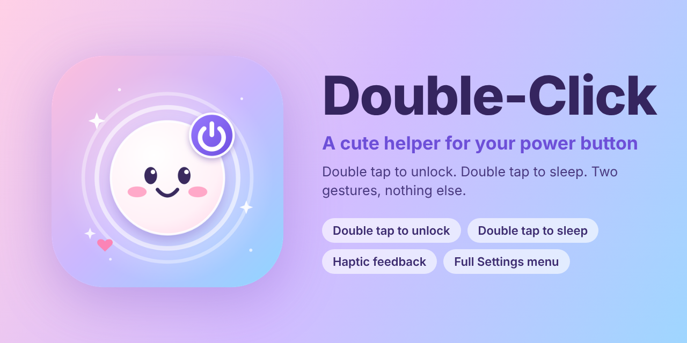

<p align="center">
  
</p>

<h1 align="center">Double-Click</h1>

<p align="center"><b>A cute helper for your power button.</b><br>
Double tap to unlock. Double tap to sleep. One tap on the Lock icon to turn the screen off.</p>

<p align="center"></p>

## Features

**1. Double tap to unlock**
- Double tap empty space on the **Lock Screen** and the unlock screen opens, exactly like pressing the Home button.
- With a passcode or Touch ID you still confirm it yourself: Double-Click never skips authentication.
- It ignores notifications, buttons and the passcode pad, so typing your passcode is never interrupted.

**2. Double tap to sleep**
- Double tap the **status bar** (top of the screen) to turn the screen off, like pressing the power button. It works on the Lock Screen, the Home Screen and inside apps while the status bar is visible.
- Double tap **empty space on the Home Screen** to turn the screen off. It never reacts to icons, folders, widgets or buttons, so normal taps are not hijacked.

**3. Lock icon on your Home Screen**
- A cute **Lock** app icon is installed. Tap it and the screen turns off right away, without opening anything.
- If the icon does not show after install, respring or run uicache (Sileo and Zebra do it for you).

**Settings > Double-Click** controls everything: a master switch, each gesture on its own, tap speed (Fast, Normal, Relaxed), haptic feedback, a Show Messages switch (small on-screen notes that tell you what Double-Click saw, useful if a tap does nothing), a Test Sleep button, Reset to Defaults and Respring.

## Where each gesture works

| Where you double tap | What happens |
| --- | --- |
| Empty space on the Lock Screen | Unlock screen opens |
| Status bar (Lock Screen, Home Screen, apps) | Screen turns off |
| Empty space on the Home Screen | Screen turns off |
| Tap the Lock icon | Screen turns off |

## Waking the phone

Double tap cannot wake a dark screen on **iPhone 8 and older**: the touchscreen is completely powered off while the screen is off, so nothing can feel the tap (only iPhone X and newer have tap to wake in hardware). Wake the phone with the Home button, Raise to Wake, or by plugging in the charger, then use Double-Click to unlock and to put it back to sleep.

## Install

Download the `.deb` from the latest successful run under the **Actions** tab (artifact `Double-Click-deb`):

| Jailbreak | Package |
| --- | --- |
| checkra1n, unc0ver, Odyssey (rootful) | `..._iphoneos-arm.deb` |
| palera1n, Dopamine (rootless) | `..._iphoneos-arm64.deb` |

Install with Filza, Sileo or Zebra, then respring. Requires `mobilesubstrate` (or ElleKit) and `preferenceloader`. Built for iOS 12 and later on arm64 devices.

## Honest notes

- Double-Click cannot unlock a passcode-protected phone by itself. It opens the same prompt the Home button does.
- Inside apps, only the status bar works, and only when it is visible and normal. Games and video players that hide it are left alone, and the green in-call bar is ignored because tapping it returns you to the call.
- The system calls used are private iOS APIs looked up at runtime, so one may do nothing on some iOS versions rather than crash. If a gesture is missing, open an issue with your iOS version and jailbreak.
- If a double tap is missed, set **Tap Speed** to *Relaxed*. If it fires by accident, set it to *Fast*.

## Build

Needs [Theos](https://theos.dev). GitHub Actions builds both packages on every push.

```sh
make package FINALPACKAGE=1                                # rootful
make package FINALPACKAGE=1 THEOS_PACKAGE_SCHEME=rootless  # rootless
```

## Icon

`assets/icon.svg` is the source for the icon: a smiling power button with two tap ripples around it.
